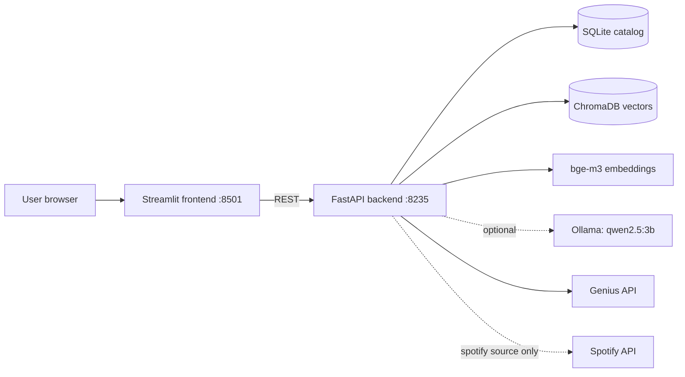
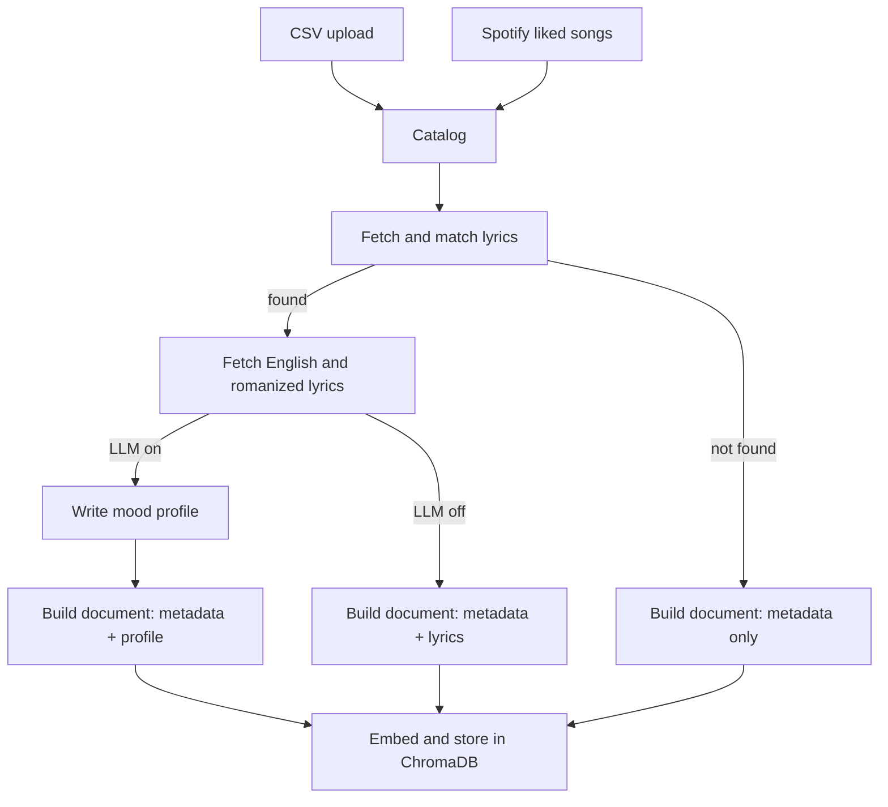
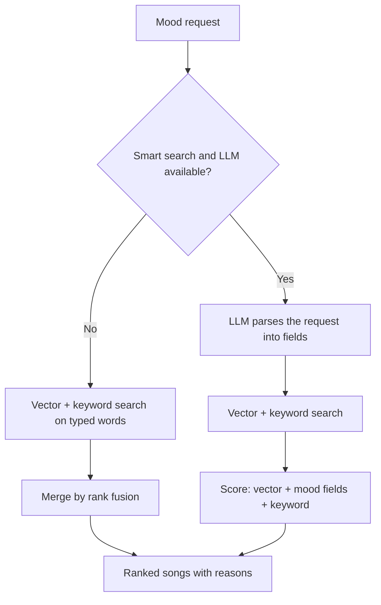
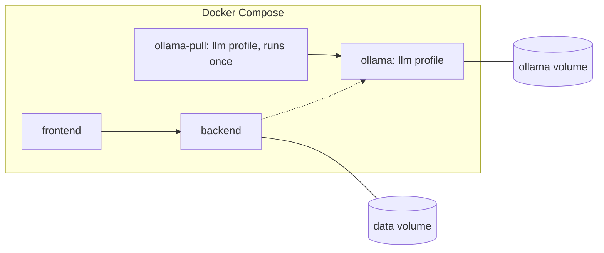

# System Architecture

## Overview

## Processing flow

## Search flow

## Modules
| File | Responsibility |
|---|---|
| `app.py` | Streamlit UI: library, mood search, playlist and lyrics pages |
| `backend.py` | REST endpoints and Spotify login |
| `pipeline.py` | CSV and Spotify sources, background processing job |
| `catalog.py` | SQLite storage of songs and stage status |
| `lyrics.py` | Genius lookup and match scoring |
| `llm.py` | Ollama client, schemas, validation and the on/off switch |
| `index.py` | Mood documents, embeddings and ChromaDB |
| `keyword_search.py` | BM25 keyword index |
| `search.py` | Smart and plain search, scoring and reasons |
| `eval.py` | Search-quality measurement |

## Data model
Main table: `songs`, with primary key `(library, track_id)`.

| Group | Columns |
|---|---|
| Identity | `library`, `track_id`, `position`, `spotify_id`, `url` |
| Metadata | `name`, `artists`, `album`, `genres` |
| Lyrics | `lyrics_status`, `lyrics`, `lyrics_english`, `lyrics_romanized`, `alt_status`, `genius_title`, `genius_artist`, `genius_url` |
| Profile | `profile` (JSON), `profile_status`, `profile_version` |
| Index | `indexed_hash` (detects when a song's document has changed) |

Each stage has its own status, which is what makes processing resumable. A library is either `csv_local` or `spotify_<user id>`.

## Main API endpoints
| Method and path | Purpose |
|---|---|
| `POST /upload_csv` | Add CSV songs and start processing |
| `POST /sync_spotify` | Read liked songs and start processing |
| `POST /process` | Process songs with pending work |
| `GET /job_status` | Processing progress |
| `GET /library_status`, `GET /songs` | Stage counts and per-song state |
| `GET /search` | Mood search |
| `POST /create_playlist` | Create a private Spotify playlist |
| `GET /login`, `GET /callback` | Spotify login |
| `GET /lyrics` | Lyrics lookup |
| `GET /health` | Status of Spotify, Genius and the LLM |

Interactive docs are at `http://127.0.0.1:8235/docs`.

## Deployment

- Frontend and backend share one 2.29 GB image with CPU-only PyTorch.
- `start.bat` reads `LLM_ENABLED` and starts Ollama only when it's on.
- Volumes keep songs, models and the Spotify login across restarts.
- Ports bind to `127.0.0.1` only, because the API has no authentication.

## Key design decisions
| Decision | Reason | Trade-off |
|---|---|---|
| LLM runs once per song, not per result | Searches stay fast and repeatable | A wrong profile stays until re-processed |
| Embed mood text, not raw lyrics | Stronger mood signal | Vector search can't find exact lyric lines (keyword search can) |
| Fixed mood vocabulary | Direct comparison without another LLM call | Less expressive than free text |
| Local LLM | Private and free | Slower and less accurate than hosted models |
| LLM optional | Runs on low-resource machines | Light mode has less mood understanding |
